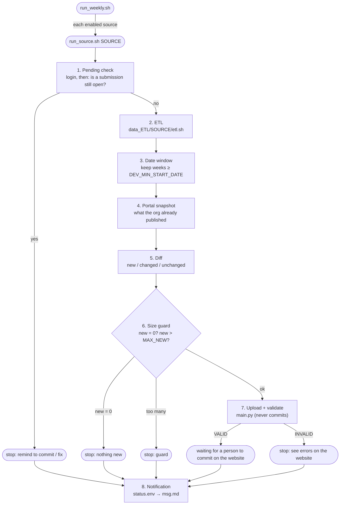

# iMicroSeq data ingestion

A weekly pipeline that downloads external wastewater surveillance data and converts it to the
[iMicroSeq data standard](data_specification/). It then **uploads and validates** the records
that are not yet on the data portal. A person reviews each submission and **commits it on the
portal website**. The pipeline never publishes anything by itself.

- **Running it week to week, without coding?** Follow **[SOP.md](SOP.md)**.
- **Adding a data source?** See **[data_ETL/README.md](data_ETL/README.md)**.
- **Working on the code?** Read this file and **[CLAUDE.md](CLAUDE.md)** (project rules).

> **Environment:** everything currently points at the **dev** portal
> (`dev.virusseq-dataportal.ca`), category `imicroseq_wastewater`. Dev only receives records
> from collection weeks on or after `DEV_MIN_START_DATE` (2026-09-01, set in `pipeline.conf`).

---

## Quick start

```bash
cd /mnt/d/OneDrive/ProjectIngestion
conda env create -f environment.yaml        # once
cp upload_workflow/.env.example upload_workflow/.env   # once, then fill in the portal login + Slack token
conda activate ProjectIngestion

./run_source.sh PHAC --dry-run   # everything except the upload: shows what would be uploaded
./run_source.sh PHAC             # upload + validate one source; then commit it on the website
./run_weekly.sh                  # every enabled source; this is what the scheduler runs
cat msg.md                       # the run's notification: what happened, what to do
```

## Folder layout

```
ProjectIngestion/
├── run_weekly.sh          scheduler entry point: every enabled source, then one msg.md
├── run_source.sh          one source end to end (steps 1-8 below)
├── pipeline.conf          pipeline-wide settings (dev date window, size limit, Slack channel)
├── msg.md                 latest notification digest (every run; posted to Slack; gitignored)
├── SOP.md                 plain-language procedure
├── CLAUDE.md              project rules for contributors
├── environment.yaml       conda env "ProjectIngestion" (requirements.txt mirrors it for pip)
├── data_specification/    the iMicroSeq standard: fields.tsv, enums.tsv
├── data_ETL/              one folder per data source
│   ├── README.md          the source contract, how to add a source
│   ├── _template/         copy-me skeleton
│   └── PHAC/              PHAC National Wastewater Monitoring of Pathogens (see its README)
├── upload_workflow/       portal API scripts + pipeline helpers (see its README)
├── runs/                  one folder per run: logs and working files (gitignored)
└── old/                   the original workflow, kept read-only for reference (gitignored)
```

## How a run works



Each source's run gets its own folder, `runs/<YYYYmmdd-HHMMSS>/<SOURCE_ID>/`. A weekly run puts all
its sources under one timestamp and adds `weekly.log`.

---

## The steps in detail

The `[n/7]` banners in the log match steps 1–7. Step 8 runs when the source finishes, however it
finishes.

### Step 1: Pending check (before any work)

| | |
|---|---|
| **What** | Logs in, then asks the portal whether a submission is still open for the source's organization. If one is, the run stops before downloading anything. |
| **Why** | Commits happen on the website, so last week's submission may still be waiting: VALID and not yet committed, or INVALID and not yet fixed. Uploading again would *append* to it and stage every record twice. New records simply go up on the first run after it is committed. |
| **Scripts** | `upload_workflow/step1_token.py` (login, via `getToken.py` and `upload_workflow/.env`), then `upload_workflow/check_pending.py` |
| **Portal calls** | Ego/Keycloak login on `ego.dev.virusseq-dataportal.ca`; `GET /category`; `GET /submission/category/{id}?onlyActive=true&organization=…` |
| **Output** | `status.env` gets `PENDING_*` values when something is open |
| **Also checks** | that the token carries the scope `WW-<ORG>.WRITE` (the organization's write permission) |
| **Fails as** | `waiting` (🟡 VALID, waiting for a commit), `waiting_invalid` (🔴 INVALID, waiting for a fix), `failed` (🔴 login, network or permission problem) |
| **Run alone** | `python upload_workflow/check_pending.py --organization PHAC-AUTOINGEST` |

The submission listing only shows the *logged-in user's* submissions, which is why this logs in
first. An anonymous call would always say "nothing open". If the check itself errors, the run
stops. It never assumes nothing is pending.

### Step 2: ETL

| | |
|---|---|
| **What** | Runs the source's `etl.sh`, which fetches the source data and writes an upload-ready CSV in iMicroSeq format. |
| **Why** | Each source has its own format, so this is the only source-specific step. Everything after it is generic. |
| **Script** | `data_ETL/<SOURCE>/etl.sh` (the contract is in [data_ETL/README.md](data_ETL/README.md); PHAC's steps are in [data_ETL/PHAC/README.md](data_ETL/PHAC/README.md)) |
| **Input → output** | source feed → `data_ETL/<SOURCE>/<UPLOAD_CSV>` (one row per sample ID). The ETL output is copied to `etl.log`. Any `[MISSING]` lines the parser prints go to `missing.txt`. |
| **Fails as** | `failed` (🔴) if `etl.sh` exits non-zero or doesn't write `UPLOAD_CSV`. Values the parser could not resolve are an FYI in `msg.md`, not a failure. |
| **Run alone** | `bash data_ETL/PHAC/etl.sh` |

### Step 3: Date window

| | |
|---|---|
| **What** | Keeps only rows whose `sample collection start date` is on or after `DEV_MIN_START_DATE` (`pipeline.conf`). While a cutoff is set, rows with no valid date are dropped too. |
| **Why** | Dev doesn't need every source's full history. An empty value means no cutoff. |
| **Script** | `upload_workflow/filter_rows.py` |
| **Input → output** | `UPLOAD_CSV` → `in_scope.csv`. The log shows `kept=… before_cutoff=… undated=…`. |
| **Fails as** | `failed` (🔴) if nothing is left in the window, which suggests a stale feed |
| **Run alone** | `python upload_workflow/filter_rows.py --input X.csv --output Y.csv --min-start-date 2026-09-01` |

### Step 4: Portal snapshot

| | |
|---|---|
| **What** | Downloads every record the organization has already **published**, as a CSV with the same column titles the ETL writes. |
| **Why** | This is the record of what is already on the portal; there is no local ledger. It stays correct however late (or whether) a person commits. |
| **Script** | `upload_workflow/fetch_published.py` |
| **Portal calls** | `GET /dictionary/category/{id}`; `GET /data/category/{id}/organization/{org}?page=…&pageSize=1000`. A 404 "No Submitted data found" means nothing is published yet. |
| **Output** | `published.csv` |
| **Value rendering** | Fields the portal omits become empty cells. Lists are joined with the field's declared delimiter (`;`). Numbers become plain text. |
| **Run alone** | `python upload_workflow/fetch_published.py --organization PHAC-AUTOINGEST --output published.csv` |

### Step 5: Diff (and the test hold-back)

| | |
|---|---|
| **What** | Splits the in-window rows by sample ID. **New** means not on the portal. **Changed** means on the portal with different values. **Unchanged** means identical. |
| **Why** | Sources republish their whole history every week. Only new records may be uploaded, since the portal rejects a sample ID it already holds. |
| **Script** | `upload_workflow/diff_new_records.py` (numbers are compared numerically, so `4.2712` ≈ `4.27120000`) |
| **Input → output** | `in_scope.csv` + `published.csv` → `delta.csv` (new; uploaded) and `changed.csv` (revised; **not** uploaded, reported as FYI) |
| **Fails as** | `failed` (🔴) if either file has a duplicate sample ID, since deduping is the source's job |
| **Test hold-back** | With `--holdout-weeks N` / `--holdout-random N`, `holdout_rows.py` moves the newest N weeks plus N random older rows out of `delta.csv` into `heldout.csv`. The next run should then find exactly those as new. Use this only to create a delta for testing. |
| **Run alone** | `python upload_workflow/diff_new_records.py --new in_scope.csv --baseline published.csv --new-out delta.csv --changed-out changed.csv` |

### Step 6: Size guard

| | |
|---|---|
| **What** | Stops when there is nothing new (`nothing_new`, 🟢). It also stops when the new count is above `MAX_NEW` (2,000; a normal PHAC week is ~150–300), unless `--force` is given (`guard`, 🔴). |
| **Why** | A sudden jump usually means the source changed how its IDs are built. Uploading would re-publish old data under new IDs. Use `--force` for an expected large batch, like a first load. |
| **Dry run** | With `--dry-run`, the run stops here (`dry_run`, 🟢) and `delta.csv` shows what would have been uploaded. |

### Step 7: Upload and validate (never commits)

| | |
|---|---|
| **What** | Renames the CSV columns to the dictionary's field names, uploads `delta.csv` as a new submission, and waits for validation. It stops there. |
| **Script** | `upload_workflow/main.py`, which chains `step1`–`step6` (see [upload_workflow/README.md](upload_workflow/README.md)) |
| **Portal calls** | `GET /category/{id}`, `GET /dictionary/category/{id}`, `GET /submission/category/{id}?onlyActive=true`, `POST /submission/category/{id}/data`, `GET /submission/{id}` (polled; an event stream) |
| **Output** | `submit/sample.csv` (renamed copy, deleted after the run) and `result.json` (`submissionId`, `status`, `url`, `rows`, `errors`) |
| **Ends as** | `review` (🟡 VALID: a person reviews and commits on the website), `invalid` (🔴 see the errors at the link) |

### Step 8: Notification (`msg.md`)

`run_source.sh` records its outcome in `status.env`. `upload_workflow/notify.py` turns all of a
run's `status.env` files into **one** Markdown digest. It is written to `msg.md` in the repo root
(overwritten each run) and to `runs/<stamp>/msg.md`. Then `upload_workflow/slack_post.py` posts
it to Slack (see below).

- **Headline:** the worst status across sources: 🔴 problem > 🟡 action needed > 🟢 all good.
- **One section per source**, showing its most important status only, with counts, collection
  weeks, the website link and the log path.
- **FYI lines** never change the headline on their own: unresolved parser values, revised
  (changed) records, test hold-backs, the dev window.
- **No spam:** one message per run, no per-step messages. Reminders repeat only as often as the
  run (weekly). A quiet week still writes a short 🟢 message, so you can tell the run happened.

| Status | Level | Meaning |
|---|---|---|
| `review` | 🟡 | Uploaded and VALID: review and commit it on the website |
| `waiting` | 🟡 | A VALID submission from an earlier run is still waiting to be committed. Nothing new was uploaded. |
| `waiting_invalid` | 🔴 | An INVALID submission is still open. Fix it or discard it on the website. |
| `invalid` | 🔴 | This run's upload failed validation |
| `guard` | 🔴 | More new records than `MAX_NEW`; nothing uploaded |
| `failed` | 🔴 | A step errored. The message says which, with the last log lines. |
| `nothing_new` | 🟢 | Everything is already published |
| `dry_run` | 🟢 | `--dry-run`: nothing uploaded; `delta.csv` shows what would be |

**Slack.** When `SLACK_CHANNEL` is set in `pipeline.conf`, the same digest is posted to that
channel, once per run, by `run_weekly.sh` (or by `run_source.sh` run on its own). Dry runs never
post.

- **How it posts:** `slack_post.py` is modeled on `old/duoli.py`. It uses the bot's OAuth token
  (`duoliauthtoken` in `upload_workflow/.env`) and `chat.postMessage`, with link previews off.
- **Markdown:** it converts `msg.md` to Slack's markdown. Headings become bold lines, `**bold**`
  becomes `*bold*`, `-` bullets become `•`, and `&`, `<`, `>` are escaped.
- **Failures:** a failed post (wrong channel, bot not in the channel, bad token) prints a warning
  in the log and doesn't change the run's outcome. `msg.md` is still written.
- **Preview** what would be posted, sending nothing:
  `python upload_workflow/slack_post.py --file msg.md --print`.

---

## What a run folder contains

`runs/<stamp>/<SOURCE_ID>/`:

| File | Kept? | Contents |
|---|---|---|
| `run.log` | yes | the full log of this source's run |
| `status.env` | yes | `KEY=value` outcome, read by `notify.py` |
| `etl.log` | yes | the ETL's own output |
| `missing.txt` | yes | values the parser couldn't resolve (empty = none) |
| `delta.csv` | yes | the new records (what was, or would be, uploaded) |
| `changed.csv` | yes | already-published records whose values changed at the source |
| `heldout.csv` | yes | test hold-back rows (only with `--holdout-*`) |
| `result.json` | yes | upload outcome (only if an upload happened) |
| `in_scope.csv`, `published.csv`, `submit/` | `--keep-work` only | bulky intermediates |

`runs/<stamp>/msg.md` is that run's digest, and `runs/<stamp>/weekly.log` is the weekly runner's
log.

## Commands and options

```
./run_source.sh <SOURCE> [--dry-run] [--force] [--holdout-weeks N] [--holdout-random N] [--keep-work]
./run_weekly.sh [--dry-run]
```

| Option | Effect |
|---|---|
| `--dry-run` | Every step except the upload. It still logs in and reads from the portal. |
| `--force` | Upload even if new > `MAX_NEW` (first loads, known backfills) |
| `--holdout-weeks N` / `--holdout-random N` | TEST ONLY: hold back rows to create a delta for the next run |
| `--keep-work` | Keep `in_scope.csv`, `published.csv` and `submit/` |

`run_weekly.sh` runs every folder in `data_ETL/` that has a `source.conf` with `ENABLED=1`.
Folders starting with `_` are skipped. A failing source doesn't stop the others. Its exit code is 1
if any source ended 🔴. Only one run can happen at a time (`runs/.lock`).

## Configuration

**`pipeline.conf`** (applies to every source):

| Key | Default | Meaning |
|---|---|---|
| `DEV_MIN_START_DATE` | `2026-09-01` | Only weeks on or after this date are uploaded. `""` = no cutoff. |
| `DEFAULT_MAX_NEW` | `2000` | Size guard for sources that don't set `MAX_NEW` |
| `SLACK_CHANNEL` | `C088LULD5PY` | Slack channel ID that gets `msg.md` after each run (#duotang-integrations). `""` = don't post. |

**`data_ETL/<SOURCE>/source.conf`**:

| Key | Example (PHAC) | Meaning |
|---|---|---|
| `SOURCE_ID` | `PHAC-NWMP` | Name used for run folders and messages |
| `ORGANIZATION` | `PHAC-AUTOINGEST` | Portal organization: the Ego scope `WW-PHAC-AUTOINGEST.WRITE` minus `WW-` |
| `CATEGORY` | `imicroseq_wastewater` | Portal category (id 3 on dev) |
| `UPLOAD_CSV` | `curated/PHAC-NWMP.dedup.csv` | What `etl.sh` writes, relative to the source folder |
| `MAX_NEW` | `2000` | Size guard |
| `ENABLED` | `1` | `0` = `run_weekly.sh` skips the source |

**`upload_workflow/.env`** (never committed): `portalUser=…` and `portalPass=…` for the portal
account, and `duoliauthtoken=…`, the Slack bot's OAuth token (only needed when `SLACK_CHANNEL` is
set). `.env.example` shows the format.

## Scheduling the weekly run

Nothing is scheduled yet. Pick a day after the source's weekly update, and choose one of these:

**Windows Task Scheduler** (recommended on this machine). It works without a WSL window open, as
long as the PC is on. Find your distro name with `wsl.exe -l -v`, then run this from Windows
(PowerShell or cmd):

```
schtasks /Create /TN "iMicroSeq weekly ingestion" /SC WEEKLY /D MON /ST 09:00 ^
  /TR "wsl.exe -d <Distro> -- bash -lc '/mnt/d/OneDrive/ProjectIngestion/run_weekly.sh'"
```

**cron inside WSL.** This only fires while WSL is running. This WSL has no systemd, so the cron
service has to be started after every WSL restart (`sudo service cron start`), unless systemd is
enabled in `/etc/wsl.conf`. Step-by-step for operators: `SOP.md`, Procedure J.

```
0 9 * * 1  /mnt/d/OneDrive/ProjectIngestion/run_weekly.sh >> /mnt/d/OneDrive/ProjectIngestion/runs/cron.log 2>&1
```

cron gives the script a bare environment (`PATH=/usr/bin:/bin`, no conda, working directory
`$HOME`). This was tested with `env -i` and works. `runs/cron.log` only captures what the
scheduler itself sees; each run's full log is in `runs/<stamp>/weekly.log`.

`run_weekly.sh` activates the `ProjectIngestion` conda env by itself. It looks for `$CONDA_EXE`,
falling back to `~/miniconda3/bin/conda`.

## Moving to prod (later, only when decided)

1. Change the dev URLs in `upload_workflow/common.py` (`DefaultBaseURL`, `DefaultPortalURL`) and
   `upload_workflow/getToken.py` (`BaseURL`).
2. Decide whether `DEV_MIN_START_DATE` stays or is cleared (full history).
3. Plan the first load. About 50k PHAC records may need to go up in chunks.

Commits stay manual on the website.

## Known limitations

- **Revised records are reported, not re-uploaded.** PHAC sometimes revises past weeks, often the
  most recent one, which is usually partial. Those show up as "changed" FYIs. The portal has an
  edit endpoint (`PUT /submission/category/{id}/data`) that could carry them later.
- **First loads are a single upload.** That is fine for the dev window (~2.5k records), but the
  prod first load needs planning.
