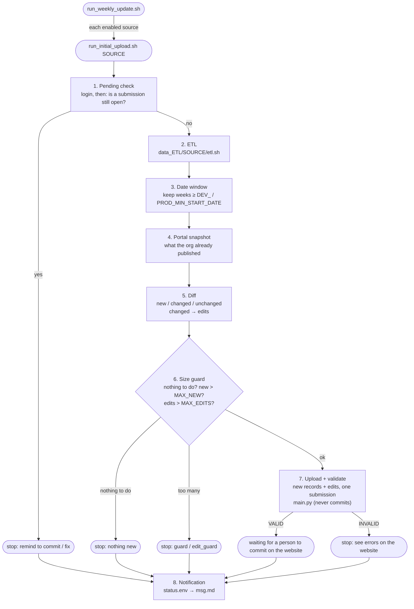

# How a run works

What the pipeline does on every run, step by step: the scripts, the files each step reads and
writes, the portal calls, and how each step can end. For the weekly routine in plain language, see
[SOP_weekly_upload.md](SOP_weekly_upload.md). For commands and settings, see
[configuration.md](configuration.md). Paths are relative to the repository folder.

## Overview



Each source's run gets its own folder, `runs/<YYYYmmdd-HHMMSS>/<SOURCE_ID>/`. A weekly run puts all
its sources under one timestamp and adds `weekly.log`.

## The steps in detail

The `[n/7]` banners in the log match steps 1–7. Step 8 runs when the source finishes, however it
finishes.

### Step 1: Pending check (before any work)

| | |
|---|---|
| **What** | Logs in, then asks the portal whether a submission is still open for the source's organization. If one is, the run stops before downloading anything. |
| **Why** | Commits happen on the website, so last week's submission may still be waiting: VALID and not yet committed, or INVALID and not yet fixed. Uploading again would *append* to it and stage every record twice. New records simply go up on the first run after it is committed. |
| **Scripts** | `upload_workflow/step1_token.py` (login, via `getToken.py` and `upload_workflow/.env`), then `upload_workflow/check_pending.py` |
| **Portal calls** | Ego/Keycloak login on `ego.<portal>` with that portal's account from `.env`; `GET /category`; `GET /submission/category/{id}?onlyActive=true&organization=…` |
| **Output** | `status.env` gets `PENDING_*` values when something is open |
| **Also checks** | that the token carries the scope `WW-<ORG>.WRITE` (the organization's write permission). Missing → `failed`; in a `--dry-run` it's only a warning plus an FYI line, so you can still see what would be uploaded. |
| **Fails as** | `waiting` (🟡 VALID, waiting for a commit), `waiting_invalid` (🔴 INVALID, waiting for a fix), `failed` (🔴 login, network or permission problem) |
| **Run alone** | `python upload_workflow/check_pending.py --organization PHAC-AUTOINGEST` |

The submission listing only shows the *logged-in user's* submissions, which is why this logs in
first. An anonymous call would always say "nothing open". If the check itself errors, the run
stops. It never assumes nothing is pending.

### Step 2: ETL

| | |
|---|---|
| **What** | Runs the source's `etl.sh`, which fetches the source data and writes an upload-ready CSV in iMicroSeq format. |
| **Why** | Each source has its own format, so this is the only source-specific step. Everything after it is generic. |
| **Script** | `data_ETL/<SOURCE>/etl.sh` (the contract is in [data_ETL/README.md](../data_ETL/README.md); PHAC's steps are in [data_ETL/PHAC/README.md](../data_ETL/PHAC/README.md)) |
| **Input → output** | source feed → `data_ETL/<SOURCE>/<UPLOAD_CSV>` (one row per sample ID). The ETL output is copied to `etl.log`. Any `[MISSING]` lines the parser prints go to `missing.txt`. |
| **Fails as** | `failed` (🔴) if `etl.sh` exits non-zero or doesn't write `UPLOAD_CSV`. Values the parser could not resolve are an FYI in `msg.md`, not a failure. |
| **Run alone** | `bash data_ETL/PHAC/etl.sh` |

### Step 3: Date window

| | |
|---|---|
| **What** | Keeps only rows whose `sample collection start date` is on or after the portal's cutoff in `pipeline.conf`: `DEV_MIN_START_DATE` (2026-09-01) or `PROD_MIN_START_DATE` (empty: full history). While a cutoff is set, rows with no valid date are dropped too. |
| **Why** | Dev doesn't need every source's full history. An empty value means no cutoff. |
| **Script** | `upload_workflow/filter_rows.py` |
| **Input → output** | `UPLOAD_CSV` → `in_scope.csv`. The log shows `kept=… before_cutoff=… undated=…`. |
| **Fails as** | `failed` (🔴) if nothing is left in the window, which suggests a stale feed |
| **Run alone** | `python upload_workflow/filter_rows.py --input X.csv --output Y.csv --min-start-date 2026-09-01` |

### Step 4: Portal snapshot

| | |
|---|---|
| **What** | Downloads every record the organization has already **published**, as a CSV with the same column titles the ETL writes, plus each record's **system ID** (the portal's own record ID, which edits need). |
| **Why** | This is the record of what is already on the portal; there is no local ledger. It stays correct however late (or whether) a person commits. |
| **Script** | `upload_workflow/fetch_published.py` |
| **Portal calls** | `GET /dictionary/category/{id}`; `GET /data/category/{id}/organization/{org}?page=…&pageSize=1000`. A 404 "No Submitted data found" means nothing is published yet. |
| **Output** | `published.csv`; `published_ids.csv` (`specimen collector sample ID,systemId`) |
| **Value rendering** | Fields the portal omits become empty cells. Lists are joined with the field's declared delimiter (`;`). Numbers become plain text. |
| **Run alone** | `python upload_workflow/fetch_published.py --organization PHAC-AUTOINGEST --output published.csv --ids-out published_ids.csv` |

### Step 5: Diff, edits (and the test hold-back)

| | |
|---|---|
| **What** | Splits the in-window rows by sample ID. **New** means not on the portal. **Changed** means on the portal with different values. **Unchanged** means identical. |
| **Why** | Sources republish their whole history every week. New records are uploaded as new; the portal rejects a sample ID it already holds. Changed records are already published, so they're sent as **edits** to those records. |
| **Scripts** | `upload_workflow/diff_new_records.py` (numbers are compared numerically, so `4.2712` ≈ `4.27120000`), then `upload_workflow/build_edits.py` for the changed records |
| **Input → output** | `in_scope.csv` + `published.csv` → `delta.csv` (new) and `changed.csv` (revised). `build_edits.py` adds each changed record's system ID from `published_ids.csv` → `edits.csv`, and counts what changes per field → `edit_fields.csv` (also printed in the log). |
| **Edits on or off** | On by default (`DEFAULT_EDIT_REVISED=1` in `pipeline.conf`). A source opts out with `EDIT_REVISED=0` in its `source.conf`; then `changed.csv` is only reported, as an FYI. `--chunk` never sends edits (it says so). |
| **Fails as** | `failed` (🔴) if either file has a duplicate sample ID, since deduping is the source's job |
| **Test hold-back** | With `--holdout-weeks N` / `--holdout-random N`, `holdout_rows.py` moves the newest N weeks plus N random older rows out of `delta.csv` into `heldout.csv`. The next run should then find exactly those as new. Use this only to create a delta for testing. |
| **Run alone** | `python upload_workflow/diff_new_records.py --new in_scope.csv --baseline published.csv --new-out delta.csv --changed-out changed.csv` |

### Step 6: Size guard

| | |
|---|---|
| **What** | Stops when there is nothing new and nothing to edit (`nothing_new`, 🟢). It also stops when the new count is above `MAX_NEW` (PHAC: 500, a normal PHAC week is ~150–300; sources that don't set it use `DEFAULT_MAX_NEW`, 2,500) (`guard`, 🔴), or the edit count is above `MAX_EDITS` (`DEFAULT_MAX_EDITS`, 2,000; PHAC revises ~70 a week) (`edit_guard`, 🔴, an error). `--force` lets either through. |
| **Why** | A sudden jump in new records usually means the source changed how its IDs are built; uploading would re-publish old data under new IDs. That many edits isn't expected either: it usually means the converter or the source changed a field across the board. Use `--force` for an expected large batch, like a first load, or send big edit batches with `run_edits.sh` (a person approves them). |
| **Chunked** | With `--chunk`, `MAX_NEW` doesn't apply, because a person confirms every chunk. `upload_workflow/chunk_rows.py` sorts `delta.csv` (after any hold-back) oldest first and cuts it into `chunks/chunk_NN.csv` of at most `CHUNK_SIZE` rows. The log lists each chunk's size and weeks. |
| **Dry run** | With `--dry-run`, the run stops here (`dry_run`, 🟢); `delta.csv` and `edits.csv` show what would have been uploaded (with `--chunk`, also the chunk plan). |

### Step 7: Upload and validate (never commits)

| | |
|---|---|
| **What** | Renames the CSV columns to the dictionary's field names, uploads `delta.csv` (new records) and then `edits.csv` (edits) into **one** submission, and waits for validation. It stops there. Either file may be missing. |
| **Script** | `upload_workflow/main.py --input delta.csv --edits edits.csv`, which chains `step1`–`step6` (see [upload_workflow/README.md](../upload_workflow/README.md)) |
| **Portal calls** | `GET /category/{id}`, `GET /dictionary/category/{id}`, `GET /submission/category/{id}?onlyActive=true`, `POST /submission/category/{id}/data` (new records), `PUT /submission/category/{id}/data` (edits), `GET /submission/{id}` (polled; an event stream) |
| **Edits** | Each edit row names its record in a `systemId` column and carries every field: an edit replaces the whole record. The portal stages them as *updates* next to the new records; the website shows each as old → new. Nothing changes until a person commits. `main.py` sends the edits only after the new records have finished validating: edits sent while the portal is still validating are accepted but never staged. |
| **Completeness check** | After validation, `main.py` checks that the submission holds as many new records and edits as were sent. If not, the run ends `failed` ("holds fewer records than this run sent"): don't commit it, close it and run again. |
| **Output** | `submit/sample.csv` and `submit/edits/sample.csv` (renamed copies, deleted after the run) and `result.json` (`submissionId`, `status`, `url`, `rows`, `edits`, `errors`) |
| **Ends as** | `review` (🟡 VALID: a person reviews and commits on the website), `invalid` (🔴 see the errors at the link) |
| **Chunked** | With `--chunk`, each chunk is its own submission, uploaded the same way. Before each one the script asks `yes` / `stop`. From chunk 2 on it logs in again and checks that the previous submission is no longer open, i.e. committed. If it is still open, it asks again. Validation may take up to an hour per chunk. `stop` ends as `review` if the last chunk still waits for its commit, else `paused` (🟡). A failed chunk ends as `invalid`. Running `--chunk` again resumes, since committed chunks are no longer new. `status.env` records `CHUNK_TOTAL`, `CHUNK_DONE`, `CHUNK_LEFT` and the current chunk's rows and weeks. |

### Step 8: Notification (`msg.md`)

`run_initial_upload.sh` records its outcome in `status.env`. `upload_workflow/notify.py` turns all of a
run's `status.env` files into **one** Markdown digest. It is written to `msg.md` in the repo root
(overwritten each run) and to `runs/<stamp>/msg.md`. Then `upload_workflow/slack_post.py` posts
it to Slack (see below).

- **Short on purpose.** A typical message:
  ```
  # 🟡 iMicroSeq (dev): action needed · 2026-11-05 13:13

  **🟡 PHAC-NWMP · review and commit**
  - New: 223 records, weeks 2026-10-11 to 2026-10-25
  - Edits: 69 published records (diagnostic measurement value 1)
  - Submission 463: VALID, 0 errors
  https://dev.virusseq-dataportal.ca/submission/environmental/463

  **🟢 CHI · nothing new**
  - 28,076 records checked
  ```
- **Headline:** the worst status across sources (🔴 problem > 🟡 action needed > 🟢 all good),
  and the run time.
- **One block per source**, worst first: a bold headline with its own dot and its most important
  status, then one labelled line per group (**New**: count and weeks; **Edits**: count and the
  fields that change, from `edit_fields.csv`; **Submission**: number, VALID/INVALID, errors), FYI
  lines, and the submission link last. The log path is added only for 🔴 problems; a failed step
  also gets the last 6 log lines.
- **FYI lines** never change the headline on their own: unresolved parser values, revised
  records that weren't sent as edits (edits off, or `--chunk`), test hold-backs.
- **No spam:** one message per run, no per-step messages. Reminders repeat only as often as the
  run (weekly). A quiet week still writes a short 🟢 message, so you can tell the run happened.

| Status | Level | Meaning |
|---|---|---|
| `review` | 🟡 | Uploaded and VALID: review and commit it on the website |
| `waiting` | 🟡 | A VALID submission from an earlier run is still waiting to be committed. Nothing new was uploaded. |
| `waiting_invalid` | 🔴 | An INVALID submission is still open. Fix the cause, then close it with `close_submission.sh` (the website can't close submissions). |
| `invalid` | 🔴 | This run's upload failed validation |
| `guard` | 🔴 | More new records than `MAX_NEW`; nothing uploaded |
| `edit_guard` | 🔴 | Error: more revised records than `MAX_EDITS`; nothing uploaded. See `edit_fields.csv` for what changed. |
| `failed` | 🔴 | A step errored. The message says which, with the last log lines. |
| `nothing_new` | 🟢 | Everything is already published |
| `dry_run` | 🟢 | `--dry-run`: nothing uploaded; `delta.csv` and `edits.csv` show what would be |
| `nothing_to_edit` | 🟢 | `run_edits.sh`: no published record needs editing |
| `cancelled` | 🟢 | `run_edits.sh`: stopped at the question; nothing sent |
| `paused` | 🟡 | `--chunk` stopped between chunks; the rest is uploaded by running `--chunk` again |

**Slack.** When `SLACK_CHANNEL` is set in `pipeline.conf`, the same digest is posted to that
channel, once per run, by `run_weekly_update.sh` (or by `run_initial_upload.sh` run on its own). Dry runs never
post.

- **How it posts:** `slack_post.py` is modeled on `old/duoli.py`. It uses the bot's OAuth token
  (`duoliauthtoken` in `upload_workflow/.env`) and `chat.postMessage`, with link previews off.
- **Markdown:** it converts `msg.md` to Slack's markdown. Headings become bold lines, `**bold**`
  becomes `*bold*`, `-` bullets become `•`, and `&`, `<`, `>` are escaped.
- **Failures:** a failed post (wrong channel, bot not in the channel, bad token) prints a warning
  in the log and doesn't change the run's outcome. `msg.md` is still written.
- **Preview** what would be posted, sending nothing:
  `python upload_workflow/slack_post.py --file msg.md --print`.

## Edits only: `run_edits.sh`

`./run_edits.sh <SOURCE> [--env dev|prod] [--dry-run]` runs `run_initial_upload.sh --edits-only`.
It does steps 1–5 as usual, then:

1. prints how many published records to edit, the per-field counts and a few sample IDs;
2. asks on the terminal: `yes` sends them, `stop` ends as `cancelled` and sends nothing (no
   terminal → it refuses before doing any work; `--dry-run` doesn't ask);
3. sends only the edits (`main.py --edits`), waits for validation (up to an hour) and ends as
   `review`, with the link.

It isn't limited by `MAX_EDITS`, since a person approves the edits. New records are not sent; the
weekly run uploads them. Use it for a big one-off sync, e.g. after a converter change, or when a
run stops with `edit_guard`.

## What a run folder contains

`runs/<stamp>/<SOURCE_ID>/`:

| File | Kept? | Contents |
|---|---|---|
| `run.log` | yes | the full log of this source's run |
| `status.env` | yes | `KEY=value` outcome, read by `notify.py` |
| `etl.log` | yes | the ETL's own output |
| `missing.txt` | yes | values the parser couldn't resolve (empty = none) |
| `delta.csv` | yes | the new records (what was, or would be, uploaded) |
| `changed.csv` | yes | already-published records whose values changed at the source |
| `edits.csv` | yes | those records with their system ID: what was, or would be, sent as edits |
| `edit_fields.csv` | yes | per field: how many records change, with an example (old → new) |
| `heldout.csv` | yes | test hold-back rows (only with `--holdout-*`) |
| `result.json` | yes | upload outcome (only if an upload happened) |
| `in_scope.csv`, `published.csv`, `published_ids.csv`, `submit/`, `chunks/` | `--keep-work` only | bulky intermediates (`chunks/` only with `--chunk`) |

`runs/<stamp>/msg.md` is that run's digest, and `runs/<stamp>/weekly.log` is the weekly runner's
log.

## Known limitations

- **Edits need a commit too.** Revised records are sent as edits and only change on the portal
  when a person commits the submission. Tested on dev 2026-11-05: edits alone (69 PHAC edits,
  submission 461) and new records with edits in one submission (223 + 69, submission 463),
  both committed and checked. On prod, dry runs only so far (PHAC: 69 edits waiting).
- **Records that disappear at the source stay on the portal.** The pipeline never deletes
  published records (the portal can, by system ID, but nothing here does).
- **Big first loads go up in chunks** (`--chunk`, 10,000 per submission, each committed before the
  next). The chunk loop has been tested with stand-in portal scripts, not yet against a real
  portal.
